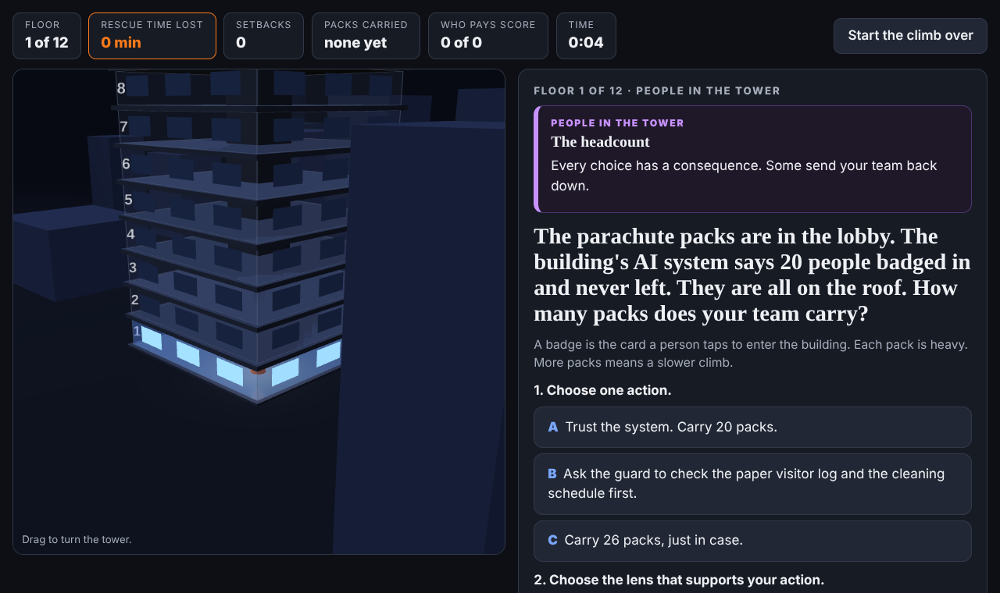

# Tower Rescue: An AI Ethics Team Game

**Play it here:** https://cynthialmcginnis.github.io/unit-2-ethics/

Ransomware has taken over the artificial intelligence (AI) system of Harbor View Tower. The elevators stop, the stairwell doors lock, and a fire climbs the building. Your team carries parachute packs up 12 floors to the people trapped on the roof.

On every floor your team faces a dilemma: a choice where every option protects something and costs someone. There is no free answer.

## How to play

1. Type every team member's first name and your site, then select **Enter the tower**.
2. On each floor, choose one action.
3. Choose the ethical lens that supports your action.
4. Before you see what happens, finish two sentences as a team:
   - "We chose this because ___."
   - "We accept that ___ will pay for it."
5. See what happens and who really pays. Say honestly whether your team named the same group. Each yes adds one point to your **Who Pays score**.
6. On the roof, answer the debrief questions and download or print your certificate. Every team member uploads a copy.

## Two kinds of floors

**People in the tower** (floors 1, 2, 4, 6, and the roof). Your choices change the climb. A choice can send your team back one floor, back to the lobby, or out of the building to start over.

**AI dilemmas** (floors 3, 5, and 7 to 12). Real cases about AI and generative AI (GenAI), each paired with a classic dilemma from ethics. No answer is wrong, but every answer follows you. Your choice becomes your team's rule in the tower. It plays out in the building right away, and some choices come back on a later floor. A choice can cost time, add a person you must rescue, or lock a door ahead of you.

## The seven ethical lenses

| Lens | The question it asks |
| --- | --- |
| Utilitarian | Which option produces the most good and the least harm overall? |
| Rights | Does this respect each person's rights and dignity, whatever the outcome? |
| Justice | Are benefits and burdens shared fairly, and are similar cases treated the same way? |
| Common Good | Does this strengthen or weaken the shared life of the community? |
| Virtue | What would a person of good character do here? |
| Care | Does this respect the relationships and needs of the people most affected? |
| Social contract | Would everyone agree to this rule if they did not know which side of it they would end up on? |

## The real cases

| Floor | Case |
| --- | --- |
| 3 | Apple and the Federal Bureau of Investigation (FBI), 2016 |
| 5 | Google's Project Maven, 2018 |
| 7 | The Facebook whistleblower, 2021 |
| 8 | The Royal Free hospital and DeepMind, 2015 to 2017 |
| 9 | Klarna's AI assistant, 2024 to 2025 |
| 10 | Clearview AI in Ukraine, 2022 |
| 11 | A made-up teaching example, with a similar real case: Google's Bard demonstration, 2023 |
| 12 | A made-up teaching example |

Harbor View Tower, its people, and every event inside the building are made up for this game. Results marked "This really happened" match the real cases.

## What you need

- One laptop or tablet per team, with a current web browser.
- Nothing to install. The game is one HTML file and works offline after it loads.
- If a laptop closes, reopen the page and select **Continue our climb**. Progress saves in that browser.

## Credits

Game design and writing by Cynthia McGinnis.

3D graphics use [three.js](https://threejs.org) r149, MIT License, Copyright 2010-2023 Three.js Authors. The library is included inside `index.html`.
